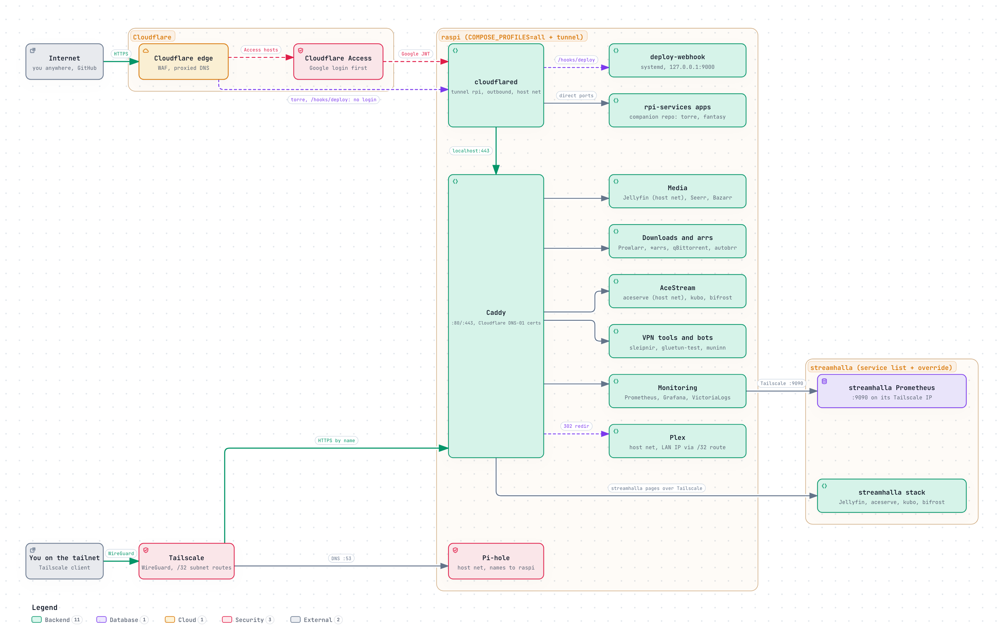

# Access

How anything here is reached, by door rather than by app. Three doors, and every app sits behind
one or more of them on purpose.

| Door | How you get in | Who decides |
| :--- | :--- | :--- |
| **Tailnet** | Tailscale on. Pi-hole resolves `*.<domain>` to the Pi's Tailscale address, Caddy routes by name | Being on the tailnet. Most apps ask nothing more |
| **Public, behind Access** | Any network, no VPN: Cloudflare's edge, Cloudflare Access, the tunnel, the Pi | Cloudflare asks for a login before anything reaches the house |
| **Public, no login** | Any network | Nobody, on purpose: only for things that must be open, and each has its own guard |

| App | Tailnet | Public |
| :--- | :---: | :--- |
| Seerr, muninn, sleipnir, subtitle-links (`subs`), torrent-drop (`drop`) | yes | behind Access |
| Grafana | through Access | behind Access, its own application (see below) |
| Deploy webhook | no | no login, `/hooks/deploy` only, HMAC-checked ([deploy.md](deploy.md)) |
| Companion repo apps | per app | some behind Access, some public by design (a public flight board, rate limited) |
| Plex | yes, on its LAN address | no ([plex-remote-access.md](plex-remote-access.md)) |
| bifrost, each node | yes | behind Access, its own application per node; only the page and its API pass the tunnel, streams answer 404. Viewers are invited from the page (bifrost's Share…) |
| Jellyfin, audio-convert, the arrs, qBittorrent, Homepage, the rest | yes | no public DNS at all |

Video never goes through Cloudflare: its terms forbid it, and TV apps cannot do a web login. Media
players stay on the tailnet and the LAN.

## The tailnet

Tailscale gives each device an address in `100.64.0.0/10`; the Pi is also the tailnet's DNS server
and an exit node ([tailscale.md](tailscale.md)).

- **DNS.** Pi-hole holds one record per HTTPS host in the Caddyfile, pointing at `TAILSCALE_IP`.
  `scripts/sync/pihole-dns.sh` writes them on every deploy, adds and removes them with their routes,
  and never touches a record it did not derive. Nothing is typed by hand.
- **Certificates.** Caddy gets real Let's Encrypt certificates by DNS-01 challenge through
  Cloudflare (`CF_API_TOKEN`), so nothing needs to be reachable for a certificate to be issued.
- **LAN.** At home without Tailscale, Caddy also answers short names (`http://jellyfin`) on
  `STATIC_IP` ([host-setup.md](host-setup.md#9-lan-short-names)).
- **Plex is the exception**: Caddy `redir`s it to the LAN address instead of proxying it, because
  Plex decides "local" from the connection it sees. Never put it behind `reverse_proxy`.
- **The second node's pages** are reached through the raspi's Caddy, over Tailscale ([nodes.md](nodes.md)).

## Public, behind Cloudflare Access

`cloudflared` (profile `tunnel`, host network) holds an outbound tunnel to Cloudflare, so nothing on
the router is forwarded for it. Each public hostname is a route on that tunnel, and each one sits
behind a Cloudflare Access application, which asks for a login (Google) at Cloudflare's edge before
the request is sent down the tunnel.

- Across the tunnel, a Cloudflare WAF rule blocks the usual scanner paths (`.env`, `.git`, `.php`,
  `wp-`), and any host or path the tunnel does not list answers 404.
- On the tailnet, Pi-hole keeps resolving the same names to Tailscale, so the tailnet path does not
  change when an app is made public.
- **Grafana** is its own Access application, so viewers can be added without opening the other apps.
  With `GRAFANA_ACCESS_JWT` set, Grafana signs people in from the Access token (new users are
  Viewers, `GRAFANA_ADMIN_EMAIL` is admin). Its hostname is listed in `PIHOLE_DNS_PUBLIC_HOSTS`, so
  Pi-hole leaves it out and it resolves to Cloudflare even on the tailnet: one login everywhere.
  `grafana-tailnet.<domain>` is the emergency door with the password form, for when Cloudflare is
  not reachable.

### Adding a public app

1. **Access application first**, so the hostname never answers without a login.
2. **The tunnel route**: straight to the app's port, or to Caddy with the right `originServerName`.
   Limit it to the paths the page needs when the same port also serves something that must stay
   private, such as video.
3. **The proxied DNS record** to the tunnel, last. Use a one-level name (`a-b.<domain>`, not
   `a.b.<domain>`): Cloudflare's free certificate does not cover two levels.
4. **The probe**: add a `prometheus.probe.access` label with the public URL. It is probed from the
   internet's side, through public DNS, and is healthy only when Access answers a stranger with the
   redirect to its login. "Public route behind Access broken" fires when one stops asking for a
   login or stops answering; it stays quiet when every public URL fails at once, which is the
   tunnel or a blocked Cloudflare range rather than the app.

## Public, no login

Only what cannot sit behind a login:

- **The deploy webhook.** GitHub cannot log in to Access, so it is public on one path and the
  receiver rejects anything without a valid HMAC signature ([deploy.md](deploy.md#security)).
- **Apps that are public by design**, in the companion repo, each with its own rate limit.

## What reaches the home address directly

The line has a public IPv4 (it was behind CGNAT until October 2026). Port 443 on it is closed and
nothing above is served from it. What does reach it: the BitTorrent port (`QBIT_BT_PORT`, forwarded
by hand on the router), and the ports aceserve maps for itself over UPnP. Plex's own Remote Access
stays off (a manual setting in Plex, not enforced by any script), so it maps nothing ([plex-remote-access.md](plex-remote-access.md#step-4--keep-plexs-own-remote-access-off)).
