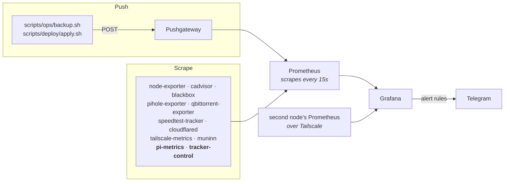

# Monitoring and alerting

How numbers and logs reach Grafana, which alerts exist, how they reach Telegram, and the one alert
that does not depend on the Pi being alive. Logs themselves are [logging.md](logging.md).

## How numbers get to Grafana

<!-- diagram: metrics-logs-alerts -->


Prometheus's own guidance is that the Pushgateway is for **batch jobs**, and its cost is the one that
matters here: a pushed series is served forever whether or not anything still produces it, and there
is no `up`. So only the daily backup and the deploy push; everything that runs forever is scraped,
where death shows as `up == 0`. That is why `tailscale-metrics`, `pi-metrics` and `tracker-control`
became services instead of cron scripts. Nothing writes node-exporter textfiles any more.

- **pi-metrics** serves the numbers no exporter provides (media, upgrades, torrents, orphans,
  indexer usage, where the disk went, zram, playback) from a snapshot refreshed in the background,
  since one media pass takes ~7 s and a scrape cannot wait. `up` says the process lives,
  `pi_metrics_last_success_timestamp_seconds` says the data is fresh: two failures, two alerts. Its
  `playback` collector runs every 60 s, so a re-encode is seen while it is happening.
- **blackbox-exporter** probes every container with a `prometheus.probe` label from the inside, and
  every `prometheus.probe.access` label from the internet's side ([access.md](access.md)). No scrape
  job to edit for a new service ([add-service.md](add-service.md)).
- **The second node's Prometheus** is a second Grafana datasource, chosen by the Node selector on the
  dashboards that have one ([nodes.md](nodes.md)).

Scrape jobs are in `config/prometheus/prometheus.yml`.

### Is an indexer being used, or just up

`prowlarr_indexer_up` answers "does it answer". `prowlarr_indexer_activity`, from
`/api/v1/indexerstats`, answers "is anything asked of it", as counters for `increase()`:

| Metric | Answers |
| :--- | :--- |
| `prowlarr_indexer_queries_total` | is anything searching it |
| `prowlarr_indexer_grabs_total` | does searching it ever produce a download |
| `prowlarr_indexer_failed_queries_total` | is it answering but failing |
| `prowlarr_indexer_response_ms` | is it the one slowing every search down |

Three alerts sit on top: every indexer down, **any enabled indexer** down for 14 h, and any indexer
failing searches for 30 m. "Any enabled" and not "any with grabs": a private tracker inside its
newbie window has zero grabs and is exactly the one whose failure needs saying.

## Dashboards

Provisioned from `config/grafana/dashboards_json/`, one folder per subject, every one linked from
Home. Changes are made in Grafana, exported and committed; the provisioned copy is read-only.

| Folder | Dashboards |
| :--- | :--- |
| infrastructure | Container Health (host and per-container, Storage section), Service probes (what Home's "Services down" is about), Deploy Monitor, Backup Monitor, Tailscale, Webhook & Tunnel |
| media | Lifecycle (when each torrent goes, films in grace, the recycle bin), Private trackers, Indexers, Disk usage, Media Pipeline, Audio languages |
| acestream | Acestream Monitor: bifrost's channels, what is playing and its swarm health, per node |
| network, services | Pi-hole; One Pace, Watch-next |

Community dashboards imported by hand: `1860` (Node Exporter Full) and `193` (cAdvisor).

## What is provisioned for alerting

Everything lives in `config/grafana/alerting/` and is **read-only in the Grafana UI on purpose**:

| File | What it does |
| :--- | :--- |
| `contact-points.yml.tmpl` | The Telegram bot Grafana sends to (rendered, see Credentials) |
| `policies.yml` | Route everything to that bot, group by alert, repeat every 6h |
| `rules.yml` | The rules, and `deleteRules` for the ones taken out. It is the full list |

What the rules cover, by group:

| Group | Rules |
| :--- | :--- |
| Host | system and data disk almost full, Pi running hot, memory almost exhausted, container restart loop |
| Deploy and backup | deploy failing, backup failed, no recent backup, backup archive grew sharply |
| Services | Prometheus target down, service not answering, public route behind Access broken, pi-metrics / tracker-control / qbit-manage overdue |
| Torrents | a requested download stalled, torrents in error, seeding to nobody, a tracker warning about to be re-checked, a torrent nothing will clean up, download nothing can import, data nothing owns |
| Trackers | almost no paid downloads left, ratio under the line, hit & run with the clock stopped, tracker numbers not being read |
| Indexers | every indexer down, an indexer down, an indexer failing its searches |
| Media | video re-encoded, audio re-encoded; AceStream source URLs failing, channel list frozen |
| Companion repo | One Pace downloads failing, the Wallapop session and pass |

Every expression uses PromQL's `bool` modifier so it returns 1 when it fires, which keeps every rule
on the same `threshold > 0` condition.

## Provisioning traps

Anything provisioned from a file here needs an explicit instruction to disappear:

- **Removing a rule is two edits**: out of `groups`, and its uid under `deleteRules`. Grafana keeps
  evaluating a provisioned rule it no longer finds in the file (one deleted rule fired six days
  later). The `deleteRules` entry can stay; re-applying it costs nothing.
- **A dashboard UID that existed and was deleted cannot be provisioned again** on Grafana v13: the
  file is read, the log says it finished, nothing appears. Give a revived dashboard a new UID.
- **A failed alerting provisioning takes Grafana's whole startup down**, not just the alert. So does a
  policy pointing at a missing contact point, which is why the render step leaves the directory empty
  when `.env` has no Telegram credentials.
- **Grafana's own `$VAR` interpolation is not used**: it re-infers the type, so an all-digits chat id
  becomes a number and the Telegram integration rejects it.

## Credentials

`TELEGRAM_ALERT_BOT_TOKEN` and `TELEGRAM_ALERT_CHAT_ID` live in `.env` and are never committed:

```
config/grafana/alerting/          in git: rules, policies, contact-point TEMPLATE
        │  scripts/deploy/apply.sh renders it (render_grafana_alerting)
        ▼
appdata/grafana-alerting/         gitignored, what Grafana actually reads
        │  bind-mounted over /etc/grafana/provisioning/alerting
        ▼
Grafana
```

The deploy restarts Grafana when a pull changes `config/grafana/alerting/`: dashboards reload on
their own, alert rules do not.

## What a message looks like

Alerts arrive grouped by `alertname`, so the rule name is the title and its instances are the list
underneath. One alert reads as a sentence, ten read as a list.

```
🚨 Deploy failing
critical · since Sep 12 00:41

The last deploy ended in error
▸ Check apply.log. Most likely a failed build or a compose error.

Silence this
```

| Element | Where it comes from |
| :--- | :--- |
| 🚨 / ⚠️ / ✅ | The `severity` label, and `.Status` for the resolved case |
| Title | `alertname`, the rule's own title |
| `since Sep 12 00:41` | `.StartsAt`, in the Pi's timezone. The Grafana service is given `TZ` for this: without it Go formats in UTC and every alert reads two hours early |
| The line of text | The rule's `summary` annotation |
| The collapsed quote | The `description` annotation, in a Bot API 10.1 expandable blockquote, so long text stays out of the way until tapped |
| Silence this | `.SilenceURL`, generated by Grafana per alert |

Deliberately absent: the firing **value**. Every rule compares with PromQL's `bool` modifier, so the
value is always 1 and printing it would say nothing. The threshold lives in the summary instead.

Two constraints on the body. Telegram caps a message at 4096 characters and truncating one with a
`parse_mode` set produces invalid HTML, which fails the whole notification rather than shortening
it. And Grafana does not HTML-escape interpolated text, so a `<`, `>` or `&` reaching a summary or a
label makes Telegram reject the message with a 400.

## Testing it

The bot only sends, so there is nothing to poll. To check the whole chain:

1. Grafana → Alerting → Contact points → `telegram-homelab` → **Test**. A message should arrive.
2. Or hit the API directly to confirm the credentials alone work:
   ```bash
   curl -s -X POST "https://api.telegram.org/bot<TOKEN>/sendMessage" \
     -d chat_id=<CHAT_ID> -d text="test"
   ```

## Adding a rule

Copy an existing block in `config/grafana/alerting/rules.yml`, give it a fresh `uid`, and write the
expression so it returns 1 when it should fire (`<something> > bool <threshold>`). Commit, and the
deploy applies it. A malformed rule is rejected at startup, so check
`docker logs grafana | grep provision` after deploying.

## An indexer down on a match night is the line, not the tracker

The first time "an indexer is down" fires for two trackers at once, the temptation is to go and fix
the trackers. Read the certificate first.

On this connection, HTTPS to the Cloudflare anycast addresses **188.114.96.5** and **188.114.97.5**
is intercepted during the Spanish football blocking windows. Every SNI gets the same self-signed
certificate back, so it is not Cloudflare answering:

```bash
echo | openssl s_client -connect 188.114.96.5:443 -servername yts.mx 2>/dev/null \
  | openssl x509 -noout -subject
# subject=C=EU, ST=SOME-ST, O=Widgits Pty Ltd, OU=Packetland, CN=core1.netops.test
```

Several trackers resolve there, so they go down together and come back together, which is the tell.
Verified on 2026-08-23: valid certificates at 16:41, the interception one at 18:16, and YTS down from
18:10 the previous evening until 05:40. Prowlarr words it as `Certificate validation for <site>
failed. RemoteCertificateNameMismatch, RemoteCertificateChainErrors`, which reads like the tracker
broke its own certificate. It did not.

Two things follow, and both are already handled:

- **The metric outlives the outage.** `prowlarr_indexer_up` reads Prowlarr's `disabledTill`, and
  Prowlarr backs a failed indexer off for up to a day, so a one-hour block used to cost a full day of
  the indexer being unusable and the alert firing over a site that works.
  `scripts/ops/indexer-retry.py` closes that gap every 15 minutes: it probes the site, and only when
  the site answers over a valid certificate does it ask Prowlarr to test the indexer, which clears
  the backoff.
- **The alert waits out the window.** "An indexer is down" needs 14h, chosen from the twenty windows
  measured in a month: none of them started before 16:45, none outlived 00:45, and the longest was
  8h. So the blocking no longer produces a message at all, and one that does arrive is a site that
  is unreachable for some other reason.
- **Nothing routes around it.** C411 used to search through a SOCKS proxy, which would have missed
  the intercepting device entirely, and the tag came off because credentials that expire in silence
  produce a failure that reads exactly like a banned account. Announce traffic is qBittorrent's and
  goes direct in any case, which is why torrents keep seeding through a window while searches fail.
  See [private-trackers.md](private-trackers.md).

## Not every transcode is worth a message

"Something is transcoding" sounds like one alert and is really three situations, only two of which
anyone can act on. `media_transcode_sessions`, from the `playback` collector in `services/pi-metrics`,
carries the labels that separate them: `stream` (video or audio) and `browser`, plus `cause` on audio.

| What is happening | Alerted | Why |
| :--- | :--- | :--- |
| **Video** re-encoded, any client | yes | The whole picture through ffmpeg. This is what makes a film buffer and the rest of the box crawl |
| **Audio** re-encoded, TV or phone, video copied | yes | The message depends on `cause`: only `codec` is a file `scripts/sync/audio-compat.py` can fix (below) |
| **Audio** re-encoded along with the video | no | The audio follows the video's re-encode whatever its codec, and the video rule has already fired |
| **Audio** re-encoded, browser | no | No browser decodes TrueHD, DTS or AC3. Plex Web re-encodes them always and nothing here changes that |
| **Remux** | no | Container change, streams copied. Jellyfin does it to the acestream Live TV channels several times a day and it is free |

The split is not theoretical. In the month before these rules existed there were three re-encodes,
all three of them audio with the video copied, and two of the three were a browser. An alert on "any
transcode" would have been right about the facts and useless twice out of three times.

Both rules wait `for: 5m`, so a re-encode that lasts a few frames while a client picks its stream, or
one seek, is not a message.

Which audio codecs get converted, and why `cause` decides it, is in
[audio-convert.md](audio-convert.md#which-codecs-get-converted-is-learned).

## The *arrs notify on their own

Radarr, Sonarr and Prowlarr have a native Telegram connection pointing at the same bot and chat,
because some things are events, not metrics: "this movie was upgraded to Bluray-1080p" has no
sensible threshold. Configured via their API, visible in each app under Settings → Connect.

| Event | Why |
| :--- | :--- |
| On Upgrade | a file was replaced by better quality (Radarr/Sonarr) |
| On Health Issue / Restored | this is where **indexer failures** show up |
| On Manual Interaction Required | an import is stuck waiting for a human |

`includeHealthWarnings` is **off**. It was on at first, so that a failing indexer would notify, and
that turned out to be the wrong place for it: every flaky indexer produced a message from all three
apps, so a single flaky indexer produced three copies of the same news. Indexer health moved to
Grafana instead, where one rule owns it and the threshold is time rather than a single failed check
(see the two indexer rules). What the apps still notify is error-level health, like an indexer whose
definition no longer exists, which does need a human.

Not enabled: On Grab and On Download. Every single import would be a message.

### Seeing upgrades without being told about them

Alerts are for things that need doing. "This movie is now Bluray-2160p" is just news, so it goes on
a dashboard instead: `services/pi-metrics/media.go` pairs each *upgrade* history event (old file
deleted with reason `Upgrade`) with the import that replaced it and exports one series per upgrade
(`arr_quality_change_*`), titles and qualities as labels, scraped by Prometheus. The **Media
Pipeline** dashboard renders them as a table, next to the qBittorrent state.

Labels as an event log is not what Prometheus is for. The alternative was the Infinity datasource
querying the *arr APIs live, which means a Grafana plugin plus each app's API key stored in Grafana.
The set here is capped at the last 25 upgrades, so it replaces itself instead of growing.

## The dead man's switch

Every rule above dies with the Pi. A power cut, a dead SD card or an ISP outage produces silence,
and silence looks exactly like "everything is fine". So the logic is inverted: the Pi says "still
alive" on a schedule, and an **external** service alerts when those pings stop.

`scripts/ops/heartbeat.sh` runs from cron every minute. It does not ping blindly: if Caddy or
Prometheus are not running it reports a failure instead, so a Pi that is powered on but broken
cannot keep sending a reassuring heartbeat.

With `HEALTHCHECK_URL` unset the script exits quietly, so a clone without an account is not broken,
just uncovered. To turn it on:

1. Create a free check at [healthchecks.io](https://healthchecks.io) and set **Period 1 minute,
   Grace 3 minutes**. Those two numbers, not the cron, decide how fast you are told: the check is
   declared down once `period + grace` passes with no ping, so this alerts about 4 minutes after
   the Pi goes dark. Going lower turns a single missed ping into a false alarm.

   The grace covers *silence*, not the failure the script reports itself. A `/fail` ping is acted on
   immediately, which is the point of it, so anything the script calls broken reaches the phone in
   seconds. That is why it does not call a deploy broken: a deploy recreates caddy, and those thirty
   seconds used to arrive as DOWN and then UP a minute later.
2. Put its ping URL in `.env` as `HEALTHCHECK_URL`.

Cost of running it every minute, measured on the Pi: **~0.2s of CPU** per heartbeat (0.12s user +
0.09s sys, so roughly 0.3% of one core) and no disk writes. The wall time is ~1s but almost all of
it is waiting on the network.

That is the only alert in this whole setup that does not depend on the Pi being alive.
