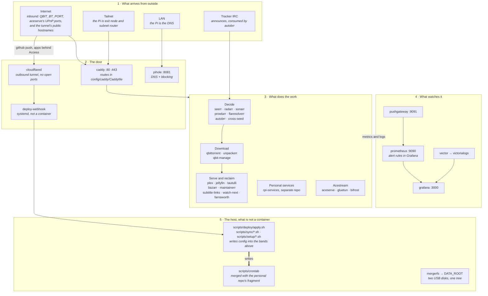

# Architecture

What talks to what, and which component is allowed to overwrite which app's configuration. This
describes the main Pi; the second node runs a subset ([nodes.md](nodes.md)). How a request gets in
is [access.md](access.md); what a deploy does is [deploy.md](deploy.md).

## The five bands

All on `media-network` except the ones on the host network: Plex, because it decides "local vs
remote" from the source IP; Jellyfin, so a TV gets a live stream URL it can reach; Pi-hole, because
it is the LAN's resolver; aceserve, so its P2P uses the home line; node-exporter, to see the host;
and cloudflared. `huginn` lives in `gluetun-test`'s network namespace.

## The network

All containers share the `media-network` bridge, and reach each other by name, except those on the
host network:

| On the host network | Why |
| :--- | :--- |
| Plex | it decides "local vs remote" from the connection it sees ([plex-remote-access.md](plex-remote-access.md)) |
| Jellyfin | so a TV gets a live stream URL it can reach |
| Pi-hole | it is the LAN's and the tailnet's resolver |
| aceserve | so its P2P uses the home line, not the VPN |
| node-exporter | to see the host |
| cloudflared | the tunnel; Prometheus scrapes it through `host.docker.internal` |

`huginn` lives in `gluetun-test`'s network namespace. A host-network service publishes nothing, so it
declares what it binds in a `host.ports` label, and CI checks both repos for port clashes. Bots reach
muninn on an internal `muninn` network, and sleipnir and muninn share docker-socket-proxy on
`docker-api`.

## What can overwrite what

Every one of these exists because the setting lives **only inside the app's own `appdata`**: no
compose file and no `.env` captures it, so without this a lost disk silently loses the tuning.

| Script | When | Writes into | Source of truth |
| :--- | :--- | :--- | :--- |
| `scripts/sync/arr-config.sh` | every deploy | Radarr, Sonarr | `config/arr/*/*.json` |
| `scripts/sync/qbit-config.sh` | every deploy | qBittorrent | `config/qbittorrent/preferences.json` + `QBIT_BT_PORT` |
| `scripts/sync/plex-prefs.sh` | every deploy | Plex | `PLEX_LAN_NETWORKS`, 95% threshold |
| `scripts/sync/arr-links.sh` | every deploy | Seerr, Bazarr | `config/seerr-links.json` |
| `scripts/sync/bazarr-prune-subs.py` | 05:40 daily | Bazarr's database | the subtitle tracks the media files actually have |
| `scripts/sync/pihole-dns.sh` | every deploy | Pi-hole | the Caddy config; only its own entries |
| `scripts/setup/install-crontab.sh` | every deploy | host crontab | both repos' `scripts/crontab` |
| `scripts/setup/install-logrotate.sh` | every deploy | `/etc/logrotate.d` | `config/logrotate/rpi-homeserver` |
| `scripts/setup/install-udev.sh` | every deploy | `/etc/udev/rules.d` | `config/udev/*.rules` |
| the tracker-control service | its own loop, every 30 min | Prowlarr, Radarr, autobrr | the measured ratio headroom |
| qbit-manage | hourly | tags, share limits, deletes into the recycle bin | `config/qbit-manage/config.yml` |
| `scripts/ops/cutoff-search.sh` | not scheduled since 2026-08-24 | nothing, triggers a search | Radarr's own Wanted list |

**A setting changed through an app's UI and not committed is reverted within 30 minutes.** That is
the design: configuration lives in git, not in `appdata`. Profiles are matched **by name**, so
renaming one creates a second, and the sync logs the same "N applied" line whether or not anything
changed, so a revert is invisible in `apply.log`.

## What git does not have

The table above is what git pushes into the apps. This is the other half, and the one that decides
how bad a dead SD card is: what each tool keeps that no file in this repo describes.

| Tool | In git | Only in `appdata`, so only in the backup |
| :--- | :--- | :--- |
| qbit-manage | **everything.** `config/qbit-manage/config.yml`, copied into `appdata` by every deploy | nothing |
| cross-seed | **everything.** `config/cross-seed/config.js`, secrets from the environment | nothing |
| Tracker economy | **everything.** `config/trackers/*.json`, seed goals in `config/qbit-manage/config.yml` | the session cookies in `appdata/tracker-stats/` |
| Grafana | dashboards and alerting, provisioned from `config/grafana/` | starred dashboards, users, silences |
| Radarr, Sonarr | custom formats and quality profiles, pushed by `scripts/sync/arr-config.sh` | indexers, root folders, the library index, history, and the API key everything else authenticates with |
| qBittorrent | preferences and BT port, pushed by `scripts/sync/qbit-config.sh` | categories, tags, and **`BT_backup`, which is every torrent it holds**. Losing that is re-adding 45 torrents by hand and starting every seed clock at zero |
| Plex | LAN networks and the 95% threshold, pushed by `scripts/sync/plex-prefs.sh` | libraries, watch history, and the claim token |
| Prowlarr | **nothing** | every indexer, and each one's API key or passkey, which is why it cannot be in a public repo |
| autobrr | **its three filters**, exported to `config/autobrr/filters.json` | the IRC network and nick, and the download client entry with its password |
| Maintainerr | **its rule groups**, exported to `config/maintainerr/rules.json` | its connections to Plex, Seerr, Radarr and Sonarr, which hold tokens, and the collections, which are rebuilt from the rules |

So one tool still lives entirely in the nightly archive, and it has no choice: every Prowlarr
indexer carries a passkey or an API key and this repo is public. autobrr and Maintainerr used to be
there too, until `scripts/ops/config-export.py` pulled the parts of them that are logic rather than
credentials into `config/`.

That script reads and never writes back, which is the opposite of everything in `scripts/sync/`. The
reason is the blast radius: pushing a filter from a file grabs the wrong thing and costs disk, while
pushing a deletion rule from a file deletes films. So a deploy runs it with `--check` and logs
`[config-drift]` when the live config and the committed copy have parted ways, and a human decides
which one is right. autobrr redacts its own indexer keys in its API (`"rsskey": "<redacted>"`), so
what is committed is the shape of the setup and not the way in.

What a restore from backup can and cannot put back is in [backups.md](backups.md).

## The scripts

Grouped under `scripts/` by what they do: `deploy/` (the pass), `setup/` (host state), `recovery/`
(by hand, after something broke), `sync/` (config pushed into apps), `ops/` (everything else on a
schedule), `ci/` (GitHub Actions). The cron lines are in `scripts/crontab`.

| Script | What it does |
| :--- | :--- |
| `deploy/apply.sh` | The deploy pass, on push and every 30 minutes. One lock, coalescing rather than queueing, with retries for a failed build: [deploy.md](deploy.md) |
| tracker-control (service) | Reads each tracker account and moves Prowlarr's freeleech filter, Radarr's `requiredFlags` and autobrr's grab rate from the headroom: [private-trackers.md](private-trackers.md#the-control-loop). One reader per site; the parsing is deliberately dumb about markup. Also puts qBittorrent on its alternative limits while anything plays on Jellyfin: [private-trackers.md](private-trackers.md#quiet-while-watching) |
| `setup/install-crontab.sh` | Merges both repos' cron fragments, installs only if it differs, prints the diff |
| `setup/install-logrotate.sh` | Installs the rotation policy root-owned 0644, because logrotate silently ignores anything else |
| `recovery/rebuild-service.sh` | Rebuilds one compose service from scratch, by hand. For one CI publishes, this is the build-from-source fallback ([service-images.md](service-images.md)) |
| `recovery/recovery-status.sh` | After a rebuild, what no API can do: the Plex claim and Jellyfin's wizard, plus a check that Grafana's database is in WAL mode |
| `sync/arr-config.sh` | Custom formats then quality profiles, in that order: profiles score formats by name and the id only exists once the format does |
| `sync/arr-links.sh` | Seerr and Bazarr's connection to the arrs. Bazarr publishes no port, so its call is proxied through the network |
| `sync/bazarr-prune-subs.py` | Bazarr keeps the embedded tracks of a file Radarr already replaced, so it stops searching for a language the new release does not have. Deletes only rows the file disproves |
| `sync/pihole-dns.sh` | Caddy's hosts as local DNS: a `*.<domain>` entry at `TAILSCALE_IP` is added, re-pointed and removed with its route; any other entry is never touched |
| `sync/plex-prefs.sh` | LAN networks, so tailnet clients are not billed as remote, and the played threshold at 95% |
| `sync/qbit-config.sh` | Queue limits and BT port. Reads back after writing, because qBittorrent accepts an unknown key and drops it |
| `services/pi-metrics/media.go` | The largest, but wide rather than deep: ten collectors of the same shape, fetch, count, emit. Answers "which", not "how many" |
| `services/pi-metrics/host.go` | Where the disk went and what zram costs. One walk answers both the largest files and the per-folder totals, counting a hardlinked inode once |
| `services/pi-metrics/main.go` | Serves both from a snapshot refreshed in the background, and exports when each collector last succeeded |
| `ops/backup.sh` | Compresses appdata, keeps 7, excludes what regenerates (Prometheus TSDB, Plex caches) |
| `ops/heartbeat.sh` | Tells an outside check the Pi is alive, and deliberately fails when the essentials are not running |
| `ops/cutoff-search.sh` | Asks Radarr to search for what it already says is missing. Decides nothing. Out of the cron, being retired |
| `ops/oci-hunt.py` | Asks Oracle for one of the two free instances every minute, which is its measured rate limit, signing by hand. Counts the runs and logs one summary an hour rather than a line each, and exits for good once both exist |
| `ops/indexer-retry.py` | Probes a backed-off indexer's site and clears Prowlarr's 24 h backoff when it answers, so an hour of blocking does not cost a day |
| `ops/config-export.py` | Pulls autobrr's filters and Maintainerr's rules into `config/`; the deploy runs `--check` |
| `ci/ports.py`, `ci/service-images.py` | Host-port clashes across both repos; which `services/` images are due ([service-images.md](service-images.md)) |
