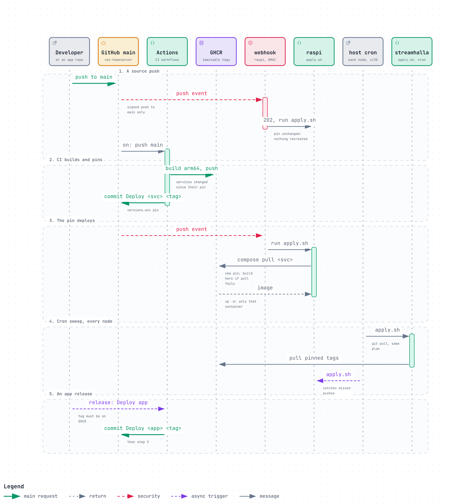
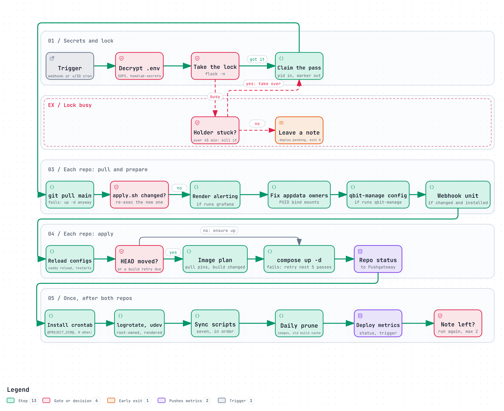

# Deploy

Nothing is deployed by hand. A push to `main` is the trigger, the repo is the source of truth, and
one script, `scripts/deploy/apply.sh`, deploys both this repo and the companion `rpi-services` on
every node. This page is what it does, why, and how the push-triggered half is set up.

## From a push to a running container



| Trigger | Where | Why it exists |
| :--- | :--- | :--- |
| GitHub webhook | main Pi only | A push lands in seconds |
| Cron, `*/30` from `scripts/crontab` | every node | Restarts what died, catches pushes made while the Pi or the tunnel was down. The only trigger on a second node |

Images built from `services/` are not built by the Pi: GitHub Actions builds them, and its
"Deploy <service> <tag>" commit is the push that deploys them ([service-images.md](service-images.md)).
Apps in their own repos (bifrost, sleipnir, muninn) are pinned the same way: their release runs this
repo's `bump-app-versions.yml` ("Deploy app"), which commits the new tag to `versions.env`. The
rpi-services apps do the same in that repo. Third-party images arrive as Renovate pull requests
([updates.md](updates.md)), and merging one is the push.

## One pass



In order, with the reason where it is not obvious:

1. **Secrets.** If `~/homelab-secrets` is a git checkout and `sops` is installed, pull it and decrypt
   `common/<repo>.env` plus `<node>/<repo>.env` (the node's names winning) over each repo's `.env`,
   only when the result differs ([secrets.md](secrets.md)).
   On a node set up this way, an edit to `.env` on the Pi is undone here.
2. **Lock.** `flock` on `.deploy.lock`; see [Concurrency](#concurrency-and-retries).
3. **Pull** with `git pull --no-rebase`: with no strategy configured git refuses to pull once the
   branches diverge, and merging keeps any local commit rather than dropping it. A commit that
   exists only on the Pi is logged as a warning. If the pull fails, the pass still runs `up -d` so
   whatever died comes back.
4. **Self re-exec.** bash reads the script as it runs, so a pull that changes `apply.sh` would keep
   executing the old code. It `exec`s the new version, passing the pre-pull commit along so the new
   run still sees what changed. The lock stays held.
5. **Render Grafana alerting** (only where `grafana` runs): compose interpolates `${VAR}` only in its
   own YAML, so the deploy combines the template in git with the Telegram token from `.env` into
   `appdata/grafana-alerting/`, which is what Grafana mounts. After the pull, before compose.
6. **Fix appdata ownership**: Docker creates a missing bind-mount directory as root, which locks out
   a container running as `1000:1000`. The list comes from the resolved compose config.
7. **Copy `config/qbit-manage/config.yml`** into appdata (only where `qbit-manage` runs): the tool
   rewrites its own config, so it cannot be handed the git copy.
8. **Restart what reads its config once**, only when the pull touched it, before any image work:
   the `deploy-webhook` unit (where installed), Grafana for alerting, `caddy reload` for
   `config/caddy/` (in either repo), Homepage for `settings.yaml`, and Vector, Prometheus and
   blackbox-exporter for theirs.
9. **Images.** A `services/` image is pulled only if its pinned tag is not on the Pi; a failed pull
   falls back to building it here. A service built here without a published image is built when its
   context changed, or when `versions.env` or a compose file did. App images (bifrost, sleipnir,
   muninn) have no build context: a new pin in `versions.env` is applied by the plain
   `docker compose up -d --remove-orphans`, which pulls the new tag.
10. **rpi-services**, the same steps from 3, skipped if the checkout is absent. Steps 5 to 8, except
    the Caddy reload, run for this repo only.
11. **Host state**: `install-crontab.sh`, `install-logrotate.sh`, `install-udev.sh`.
12. **Sync scripts**, after compose because the apps must be up. What each writes is in
    [architecture.md](architecture.md#what-can-overwrite-what).
13. **Daily prune** of images and week-old build cache, then **metrics** to Pushgateway: a status per
    repo right after each one deploys (`deploy_repo_last_status`), then the overall
    `deploy_last_status` and the trigger. The "Deploy failing" alert and the
    Deploy Monitor dashboard read them.

`runs <service>` asks compose which services this node's `COMPOSE_PROFILES` enables. It gates three
steps: the Grafana render, the qbit-manage copy and `config-export.py --check`. The other sync
scripts skip themselves when their app is not there, and the webhook unit is only touched where it is
installed ([nodes.md](nodes.md)).

### Only what changed is recreated

A recreate cuts what the container was serving: Caddy's live connections, the stream Jellyfin is
reading from bifrost. Three things keep recreates to the containers whose image really changed:

- `up` runs **without `--build`**. `--build` recreates every built container even when its image is
  identical.
- A pinned tag moves only when that service's directory or build args changed.
- BuildKit's default provenance attestation is timestamped, so a cached build still got a new image
  id. The deploy exports `BUILDX_NO_DEFAULT_ATTESTATIONS=1`.

`DEPLOY_BUILD_LOCAL=1 bash scripts/deploy/apply.sh` builds the published services from source on
this pass, for when CI or GHCR is down.

## Concurrency and retries

Cron and the webhook can both fire it. A run that cannot take the lock does not wait: it leaves
`.deploy.pending` and exits, and the holder runs once more on its way out (at most twice). Coalescing,
not a queue: ten pushes during an ARM Go build cost one extra pass. A holder running for more than
45 minutes (`DEPLOY_STUCK_AFTER`) is treated as stuck and killed.

**A failed build is owed a retry.** By the next pass the commit that caused it is already pulled, so
the diff is empty and nothing would ever build it again. A failed build leaves
`.deploy.build-failed.<repo>` with a count, later passes rebuild up to five times
(`DEPLOY_BUILD_RETRIES`), and then stop and leave it to the "Deploy failing" alert. Every command
whose status matters runs through `stream_logged`: piping into a `while read` loop reports the loop's
status, which once recorded a failed build as a success.

## The webhook

```
GitHub push ──► https://deploy.<domain>/hooks/deploy
                        │  (Cloudflare edge)
                        ▼
                 cloudflared container  ──► 127.0.0.1:9000
                                                │  deploy-webhook.py (systemd, user raspi)
                                                │  verifies X-Hub-Signature-256
                                                ▼
                                        scripts/deploy/apply.sh  (under flock)
```

### Security

The public URL is reachable by anyone, so the receiver treats every request as hostile:

- **HMAC first.** Every request must carry `X-Hub-Signature-256`, an HMAC-SHA256 of the raw body
  keyed with `GITHUB_WEBHOOK_SECRET`, compared with `hmac.compare_digest`. No valid signature means
  401 and the deploy script is never reached.
- Only `POST` on the exact hook path, bodies capped at 1 MiB, only `push` events on
  `refs/heads/main`, and only for a hardcoded repo allowlist. Nothing from the payload is ever
  passed to a shell.
- The receiver binds `127.0.0.1`, so the tunnel is the only way in. It runs as `raspi`, not root.
- Cloudflare Access does **not** work in front of a webhook: GitHub cannot do an interactive login
  and cannot send service-token headers. A WAF rule limited to GitHub's hook ranges
  (`https://api.github.com/meta`, `hooks`) is the optional second layer; those ranges change.

### Setup

1. **Tunnel** (Cloudflare dashboard, once): Zero Trust → Networks → Tunnels → Create a tunnel →
   Cloudflared, named `rpi`. Put its token in `.env` as `CLOUDFLARED_TUNNEL_TOKEN`. Add the public
   hostname `deploy.<domain>`, path `hooks/deploy`, service `HTTP` → `127.0.0.1:9000`. Never a
   catch-all hostname; other apps on the same tunnel go behind Access first ([access.md](access.md)).
2. **Receiver** (on the Pi):
   ```bash
   openssl rand -hex 32                       # GITHUB_WEBHOOK_SECRET in .env
   sudo cp services/deploy-webhook/deploy-webhook.service /etc/systemd/system/
   sudo systemctl daemon-reload
   sudo systemctl enable --now deploy-webhook
   systemctl status deploy-webhook            # "listening on 127.0.0.1:9000/hooks/deploy"
   ```
3. **cloudflared**: add `tunnel` to `COMPOSE_PROFILES`. `all` does not include it, because with an
   empty token it would crash-loop. Then `COMPOSE_ENV_FILES=versions.env,.env docker compose up -d cloudflared`.
4. **GitHub**, in `rpi-homeserver` and `rpi-services` → Settings → Webhooks: payload URL
   `https://deploy.<domain>/hooks/deploy`, content type `application/json`, the secret, push events
   only. GitHub sends a `ping` on save; the receiver answers `pong`.

### Changing the receiver

It is a host systemd service, so a pull alone would leave the old process serving. When a pull
touches `services/deploy-webhook/`, the deploy reinstalls the unit if it changed, runs
`daemon-reload` and restarts it. That restart happens from inside a deploy the same service may have
spawned, which is why the unit sets **`KillMode=process`**: with systemd's default (`control-group`)
the restart would kill the deploy that asked for it. `start_new_session` in the Python side does not
help: it changes the session, not the cgroup.

## Troubleshooting

```bash
tail -f ~/rpi-homeserver/apply.log            # the deploy itself
journalctl -u deploy-webhook -f               # receiver: signature rejections, triggers
docker logs -f cloudflared                    # tunnel health
```

- `401 unauthorized` in the journal: the secret in `.env` and in the GitHub webhook differ. Restart
  the service after changing it.
- Deliveries time out: tunnel down, or the hostname points somewhere other than `127.0.0.1:9000`.
- `Another deploy is already running; left a note for it to run again.`: expected when several
  pushes land together.
- `WARNING: N commit(s) exist only on this Pi`: push them; the SD card is the only copy.
- A container did not pick up a change: check its image tag against `versions.env`, then
  `bash scripts/recovery/rebuild-service.sh <service>`.
