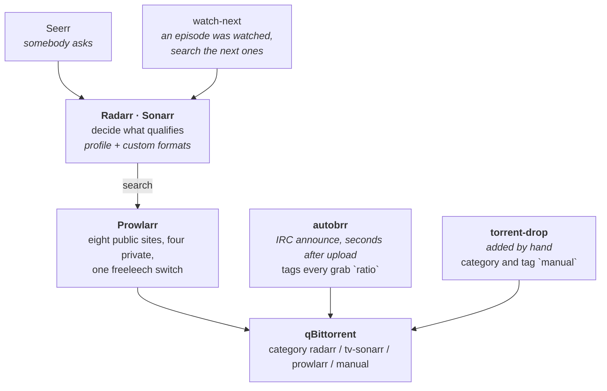
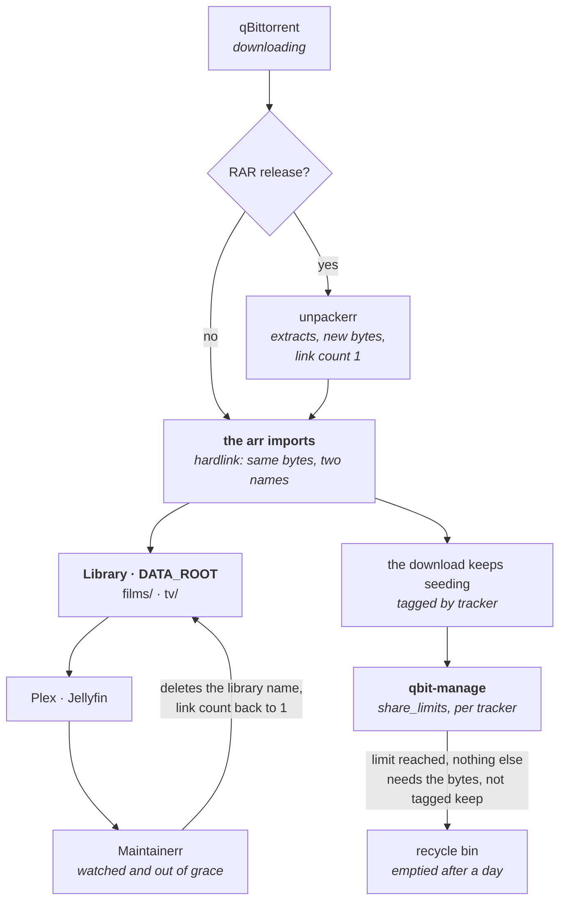

# Lifecycle of a torrent

From the indexer to the recycle bin, for a film and for an episode: what decides each hop, and where
its number is configured. This is the single source for retention and deletion.

Two things make it harder than a straight line: the same bytes carry two names (the download and the
library hardlink), and each tracker asks for a different amount of seeding before a torrent may go.

## The deletion policy

The rule of record. Everything below is its implementation, and any doubt is settled here:

1. **Nothing is deleted before it has been watched.** Watched is Plex's verdict, at 95% of the
   runtime, so a film abandoned in the credits does not count.
2. **A watched film is deleted two days later**: library copy gone, unmonitored in Radarr. The delay
   leaves room to rewatch it, for someone else in the house to see it, or to notice that Plex marked
   something watched by accident. The delete is not reversible.
3. **The torrent is a separate debt, and the tracker decides when it is paid.** A public torrent goes
   two hours after it finished. A private one seeds until it has met that tracker's own hit & run
   rule plus a margin, because leaving early is how an account gets banned. Disk pressure is never a
   reason to pay less.

## The two ways in

<!-- diagram: torrent-lifecycle -->

**Asked for** goes through the arrs: they decide whether a release qualifies
([media-policy.md](media-policy.md)), Prowlarr searches, qBittorrent downloads into the category the
arr owns. RSS every few minutes catches anything new. **Announced** comes from autobrr, which grabs
within seconds of an upload on a tracker's IRC channel; those exist only to build ratio and carry the
`ratio` tag for life. **Added by hand** comes from torrent-drop (below).

Heavy night jobs avoid 02:00 to 05:00: Plex's own maintenance holds that window and costs 0.4 cores
and 52 MB/s of reads, on the same two USB platters the downloads write to.

## From download to library

The hardlink count is the signal everything rests on: while the library holds the file, seeding it
costs no disk. **A film that is still seeding is normally still in Plex, for free**: what qBittorrent
seeds and what Plex plays are the same bytes under two names. Two cases break the count:

- **RAR releases.** unpackerr writes new bytes, so the extracted file has one link from the start.
  RAR packs are now rejected outright for this reason ([media-policy.md](media-policy.md#rar-packs-are-rejected-outright)).
- **Cross-seeds.** A second torrent on the same files keeps the count above 1. cross-seed injects
  them as `<category>.cross-seed` (e.g. `radarr.cross-seed`), which the hardlink check never
  inspects; they carry the `cross-seed`
  tag, and the `cross-seed` group releases them after 15 days.

An episode follows the same path; watch-next fetches the next ones as you watch
([watch-next.md](watch-next.md)).

## The tags are the retention policy

qbit-manage tags each torrent with its tracker and with whether anything still needs the bytes.
Nothing is deleted for one reason alone: a group has to match the tracker **and** find the file free
to go.

| Tag | Written by | Meaning |
| :--- | :--- | :--- |
| `torrentleech`, `digitalcore`, `c411`, `retrotoon` | qbit-manage, from the announce URL | Which site's rules apply |
| `private` | qbit-manage | A private swarm. There is no `public` tag: public is the absence of this one |
| `noHL` | qbit-manage | The library no longer holds the file; the bytes are kept only for the tracker |
| `ratio` | autobrr | Grabbed for ratio, never in the library. Without it these would be invisible: no category, so the hardlink check never inspects them |
| `stalledDL` | qbit-manage | No seeder found. Added and removed by the tool as the state changes |
| `issue` | qbit-manage | The tracker no longer recognises the torrent. Tagged, not removed: a reset passkey looks exactly like this |
| `keep`, `keep-bonus` | a person; tracker-control | Out of every clock |
| `cross-seed`, `radarr.cross-seed` | cross-seed | A second tracker on bytes another one brought |
| `manual` | torrent-drop | Added by hand; selects the one group that never deletes the file |
| `xseed` | torrent-drop | cross-seed was already asked about it |

Two exceptions delete on a single condition, both somebody else's judgement: `rem_unregistered`
removes only what the site itself has disowned, and the `stalled` group removes a download that found
no seeder (it never completed, so a tracker group would wait forever on seeding time it cannot have).

## What each tracker asks, and what is configured

Every site is asked for more than it demands, because two clocks disagree: qBittorrent counts from
completion and keeps counting while announces are rejected, while the site starts at its first
announce. Measured gaps: 26 to 118 hours on TorrentLeech, 9 to 23 hours on DigitalCore. The margin is
that gap, not a guess. Lower priority is evaluated first.

| Group (priority) | The site asks | Configured | Why |
| :--- | :--- | :--- | :--- |
| stalled (1) | — | removed 12 h after the last byte moved | Before its tracker's group, which would wait forever. A download that finds a seeder leaves the group |
| cross-seed (2) | — | 15 d, no ratio limit | It downloaded nothing, so ratio is upload over zero and any limit fires on the first byte served. 15 d is the longest of the four sites |
| manual (3) | nothing | 15 d, no ratio limit, **file never deleted** | `cleanup: false`: the term is served, qBittorrent stops the torrent, the file stays. Above `public`, which would take a manual public download after 2 h |
| torrentleech (4) | 240 h or 1:1 | 15 d, ratio 1.2 | The widest clock gap measured |
| retrotoon (5) | 72 h, no ratio rule | 120 h, no ratio limit | Only time clears there, so `max_ratio: -1` |
| c411 (6) | 72 h, 24 h grace | 150 h, ratio 1.0 | Their H&R is disabled site-wide, so a thinner margin is affordable |
| digitalcore (7) | 120 h from 10% progress | 180 h, ratio 1.0 | Nearly triple the worst gap on their own My Seeds page |
| private (8) | — | 10 d, ratio 1.0 | The floor, so a new site is covered from its first torrent |
| public (9) | — | 2 h, no ratio limit | Selected as "not tagged private". Dropped even while the library shares the file: the point is leaving public swarms |

`min_last_active: 1d` is the third condition on every private group: a torrent still moving bytes is
still paying, and on a freeleech every byte up is profit. Anything that trickles is kept; what stops
that from costing disk is the free-space floor that pauses the grabber.

Deletion moves files to `/data/downloads/.RecycleBin`, emptied after `recyclebin.empty_after_x_days`
(1). A wrong call is recoverable for a day, and only then does the space come back: the bin is on the
same disk. The orphan scan skips `.RecycleBin` and `orphaned_data`.

**The override is a tag.** Every group excludes `keep` and `keep-bonus`, so tagging a torrent takes it
out of the clock with no deploy and no config change.

### qbit-manage traps

- **Unknown keys are ignored silently.** `settings.public_tag` once matched nothing, so no public
  torrent had a limit. Check a key against the schema of the installed version.
- **`--dry-run` is not read-only** with `share_limits` on: it writes real per-torrent limits and its
  own tags. Preview from the tool's log instead.
- **Resetting a limit on qBittorrent 5.2** needs all four of `ratioLimit`, `seedingTimeLimit`,
  `inactiveSeedingTimeLimit` and `shareLimitAction`, or the API answers 400.
- Its config is copied from git into `appdata` by the deploy, because the tool rewrites its own file.

## Added by hand

`services/torrent-drop/` serves `drop.<domain>`: drop a `.torrent`, paste a magnet, an https link or
an infohash, and it goes into qBittorrent with the `manual` category and tag, without logging into
qBittorrent.

- **A manual download is never deleted.** No arr requested it, so nothing would fetch it again. The
  `manual` group serves the tracker's term and stops the torrent; the file stays. The page's
  "seguir sembrando" checkbox adds `keep`, which keeps it seeding.
- **Every torrent gets a cross-seed search the moment it completes**, not a day later: a 30-second
  poll asks cross-seed's `/api/webhook` and writes the `xseed` tag. The ask carries
  `ignoreExcludeOlder` and `ignoreExcludeRecentSearch`, without which a release over 180 days old is
  skipped in silence. On start it marks what is already complete without searching, or it would send
  hundreds of queries to the private trackers at once.
- `max_active_downloads` is 1, so a torrent added while Radarr downloads waits in `queuedDL`; the page
  says so.

## When the library copy goes: Maintainerr

Maintainerr's rules are exported to `config/maintainerr/rules.json` (the deploy reports drift, it
never pushes: a wrong rule deletes films). Its connections and collections live in `appdata`.

| Collection | Library | Rule |
| :--- | :--- | :--- |
| `Pending deletion` | films | Plex `lastViewedAt` before now − 2 days **AND** `viewCount` > 0 |
| `Watched episodes` | series | the same shape, for episodes Sonarr manages; One Pace is excluded |

The collection name is visible: Maintainerr creates a real Plex collection from it.

- **Two conditions, not one.** Plex writes `lastViewedAt` when playback *starts* and `viewCount` only
  when it finishes, so the date alone treats ten seconds of browsing as watched.
- **95% is watched**: `LibraryVideoPlayedThreshold` is pushed by `scripts/sync/plex-prefs.sh`. Plex's
  default 90% is inside the credits.
- **It deletes through Radarr** (`arrAction=1`, `UNMONITOR_DELETE_ALL`, `radarrSettingsId` set).
  Without an arr it falls back to deleting through Plex: the file goes, the film stays monitored, and
  the next search downloads it again (one film rode that loop for a week, a new copy every night).
  `cleanupLeftoverFolders` removes the empty folder Radarr leaves.
- **`deleteAfterDays` is 0**: the rule's own threshold is the only wait, not a second grace period.
- **The download client is deliberately not wired.** Its criterion trusts the client's seeding goal
  and falls back to ratio 0.5, which is a hit & run on TorrentLeech; and against qBittorrent 5.x it
  never worked (it reads the cookie as `SID=`, qBittorrent names it `QBT_SID_8080`). qbit-manage owns
  the torrent side.
- **Tautulli is wired and the rules do not use it.** Tautulli only records what streams through this
  server, while Plex also syncs watch state from plex.tv for plays elsewhere, so a Tautulli rule
  would never delete those.
- **An unmatched Plex item can never be deleted**, and it fails per item: a film matched locally has
  `guid="local://<id>"`, and the run logs `Couldn't resolve any supported external IDs`. Fix the
  match in Plex (Fix Match, or `PUT /library/metadata/<id>/match?guid=plex://movie/...`).

In the export, `firstVal` is `[application, property]` (`[0,7]` Plex `lastViewedAt`, `[0,5]` Plex
`viewCount`), `action` is `RulePossibility` (5 `BEFORE`, 0 `BIGGER`), and
`GET /api/rules/constants` lists every property.

## Orphaned downloads

**A film deleted from the arr while its download is in flight becomes an orphan.** The download
finishes with nothing to import into, stays in the queue as `importBlocked` (`Movie title mismatch`),
and Radarr re-sends its `onManualInteractionRequired` alert **on every restart**. Deleting the queue
entry does not stick: the arr rebuilds its queue from the client. What clears it:

1. In qBittorrent, **take the torrent out of the arr's category** (safe while `auto_tmm` is off: nothing
   moves on disk). The arr never sees it again.
2. Leave the rest to qbit-manage, which asks about hardlinks and trackers, never categories, so the
   torrent still pays its tracker and goes on schedule.

pi-metrics exports both this and data a removed torrent left behind as `arr_orphan_*`, alerted as
"Download nothing can import" and "Data in downloads that nothing owns".

## Watching the countdown

The **Lifecycle** dashboard answers "when does each thing go". It does not restate the policy: when a
group claims a torrent, qbit-manage writes the limit into qBittorrent, and the dashboard subtracts
what has been seeded from the limit the client holds. Change a group and the countdown follows. A
torrent missing from the table is information: no group matched (the library still shares it, `-2`
in the client) or the group cleared the limit because it is still paying (`-1`). It also shows what
the recycle bin holds and how much of it frees space (a file the library still hardlinks frees
nothing).

## Where each number lives

| Decision | File |
| :--- | :--- |
| What qualifies as a release | `config/arr/radarr`, `config/arr/sonarr` |
| Which indexers, and the freeleech switch | Prowlarr, written by tracker-control |
| Grabs per day for ratio | autobrr filter, written by tracker-control |
| How long each tracker is seeded | `config/qbit-manage/config.yml`, `share_limits` |
| What the site actually asks | `config/trackers/rules.json` |
| When the library copy goes | Maintainerr, exported to `config/maintainerr` |
| Queue limits and BT port | `config/qbittorrent`, written by `sync/qbit-config.sh` |

How hard each tracker is worked (the headroom tiers) is in
[private-trackers.md](private-trackers.md#the-control-loop).
